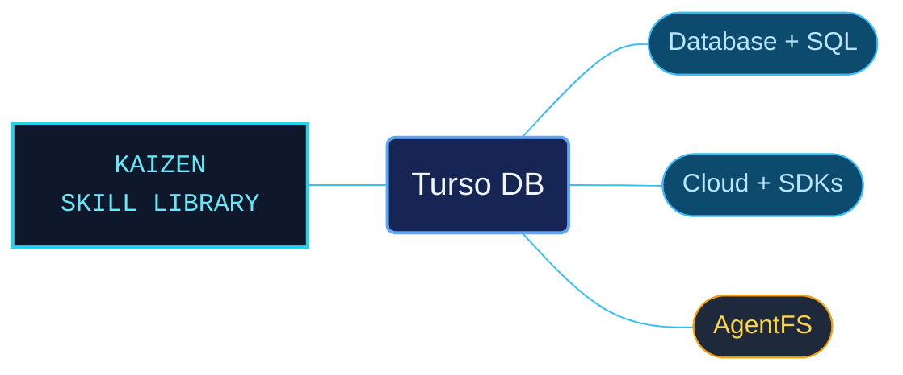

# Turso DB

Turso references spanning database behavior, SQL, application connections, managed cloud operations and AgentFS. Seven reference-area subskills provide separate entrypoints so an agent can select the relevant product surface before using a command or API.

Use when working with Turso Database, Turso Cloud, libSQL, AgentFS, Turso CLI, Turso Platform API, SDKs, SQL reference, sync, migrations, auth tokens, groups, organizations, vector search, embedded replicas, local development, SQLite compatible databases, or Turso connection code.

## What this skill helps with

| Task | Useful reference material |
| --- | --- |
| [Choose the database surface](references/database-core/README.md) | Distinguish Turso Database, libSQL and their documented local or cloud workflows. |
| [Connect an application](references/sdks/README.md) | Find language SDKs, connection modes, authentication and integration guidance. |
| [Check SQL behavior](references/sql-reference/README.md) | Look up statements, functions, PRAGMAs and SQLite compatibility conditions. |
| [Manage hosted resources](references/turso-cloud/README.md) | Locate cloud configuration, replica, migration and access-control references. |

## Included reference-area subskills

| Subskill | Use it for |
| --- | --- |
| [Database Core](references/database-core/README.md) | Engine concepts, quickstarts, local development, sync and versioned features. |
| [SQL Reference](references/sql-reference/README.md) | SQL syntax, functions, schema operations and compatibility. |
| [SDKs](references/sdks/README.md) | Language clients, framework integrations and connection authentication. |
| [Turso Cloud](references/turso-cloud/README.md) | Managed database configuration, replication, access and deployment. |
| [Turso CLI](references/cli/README.md) | Installation, authentication, tokens and resource management commands. |
| [Platform API](references/platform-api/README.md) | HTTP contracts for databases, groups, organizations and account operations. |
| [AgentFS](references/agentfs/README.md) | Agent filesystems, overlays, audit logs, sandboxing and SDK access. |

## The work behind the references

The material is grouped under one references tree, with focused catalogs and entrypoints for each area. API examples retain their endpoint, token, schema and dependency context, while release history remains tied to its original version and date.

## Start here

Start with [SKILL.md](SKILL.md) and follow its context routes.

Keep Turso Database and libSQL behavior distinct. Match examples to their documented SDK, runtime, authentication role and feature availability. A historical release entry describes that release rather than the current state of every hosted service.

## Sources and license

Skill reference documentation is interpreted content for use in open source projects. Check against [official documentation sources](https://docs.turso.tech/) when dealing with defects or issues that may come up from interpreting this skill's references.

Licensed under **AGPL-3.0**; see [LICENSE](LICENSE). Part of the [Agent Kaizen](https://github.com/LevyBytes/agent-kaizen) skill library.
