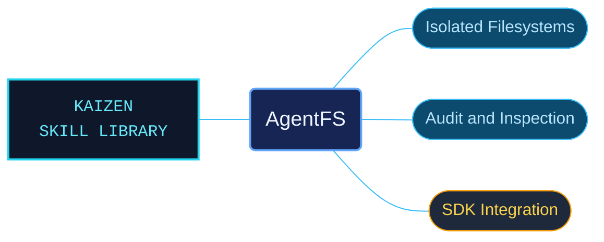

# AgentFS

AgentFS references for giving coding agents an inspectable filesystem and persistent working state. The material connects isolated overlays, activity records and shared sessions with the commands and SDKs used to manage them.

Use for AgentFS agent filesystems, copy-on-write overlays, audit logs, MCP and NFS access, shared sessions, sandboxed coding workflows, Turso Cloud sync, installation and CLI commands, or Python, Rust and TypeScript SDK storage and tool-call APIs. Preserve the documented SDK language, platform and availability limits.

## What this skill helps with

| Task | Useful reference material |
| --- | --- |
| [Isolate filesystem changes](overlay-layers-creation-and-diffs.md) | Create overlays and inspect differences before applying changes. |
| [Inspect agent activity](audit-timeline-filters-and-json.md) | Use timelines, SQL and filesystem views to investigate recorded work. |
| [Integrate an agent workflow](coding-agent-sessions-and-review.md) | Connect filesystem isolation with the documented coding-agent workflows. |

## The work behind the references

Filesystem operations, audit capabilities and language SDK contracts are separated into focused catalogs, retaining platform and availability conditions with their examples.

## Start here

Start with [SKILL.md](SKILL.md) and follow its context routes.

Select the documented platform and SDK before adapting an example. MCP, NFS, shared sessions and cloud synchronization have separate routes in the context router.

## Sources and license

Skill reference documentation is interpreted content for use in open source projects. Check against [official documentation sources](https://docs.turso.tech/agentfs) when dealing with defects or issues that may come up from interpreting this skill's references.

Licensed under **AGPL-3.0**; see [LICENSE](../../LICENSE). Part of the [Agent Kaizen](https://github.com/LevyBytes/agent-kaizen) skill library.
