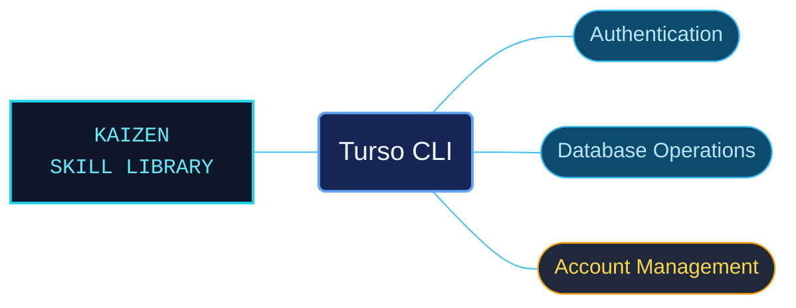

# Turso CLI

Turso CLI references for managing database resources and account access from the terminal. Command families are grouped around authentication, database and group operations, and organization administration.

Use when installing or updating the Turso CLI, authenticating, managing API or database tokens, configuring database access rules, creating or inspecting databases, using the SQL shell and local development server, managing groups or organizations, selecting account plans, or using headless mode and command help.

## What this skill helps with

| Task | Useful reference material |
| --- | --- |
| [Authenticate and manage access](authentication-and-contact-commands.md) | Find authentication and contact commands while keeping token roles distinct. |
| [Manage databases and groups](database-and-group-commands.md) | Select commands for database resources and their groups. |
| [Set up the CLI and account](installation-organization-and-account-commands.md) | Find installation, organization and account-management guidance. |

## The work behind the references

Command references are organized by operational purpose, with links to the focused arguments and setup details needed for each command family.

## Start here

Start with [SKILL.md](SKILL.md) and follow its context routes.

Keep platform tokens and database tokens distinct. Check the selected organization, database and documented command prerequisites before running an example.

## Sources and license

Skill reference documentation is interpreted content for use in open source projects. Check against [official documentation sources](https://docs.turso.tech/cli) when dealing with defects or issues that may come up from interpreting this skill's references.

Licensed under **Apache-2.0**; see [LICENSE](../../LICENSE). Part of the [Agent Kaizen](https://github.com/LevyBytes/agent-kaizen) skill library.
