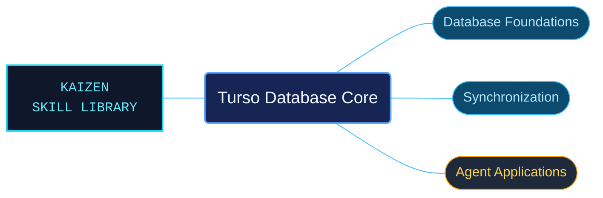

# Turso Database Core

Turso database concepts and implementation guidance for local applications, synchronized data and agent workloads. The references distinguish the database engine, libSQL and cloud entrypoints before moving into their feature-specific workflows.

Use when working with Turso Database core concepts, libSQL distinctions, embedded or cloud quickstarts, local development, agent databases, persistent AI memory, code indexing, content caching, encrypted secrets, vector search, sync, change data capture, concurrent writes, encryption or versioned database release history.

## What this skill helps with

| Task | Useful reference material |
| --- | --- |
| [Choose an engine and quickstart](database-selection-and-quickstarts.md) | Compare the documented product surfaces and embedded or cloud setup. |
| [Synchronize application data](database-sync-workflows.md) | Find checkpoints, conflict resolution and partial sync; follow [change data capture workflows](change-data-capture-workflows.md) for change records. |
| [Build persistent agent context](agent-memory-and-code-indexing.md) | Explore agent databases, AI memory and code-indexing patterns. |

## The work behind the references

Concepts, feature guides and dated release history have distinct catalogs so historical changes do not become unqualified statements about current behavior.

## Start here

Start with [SKILL.md](SKILL.md) and follow its context routes.

Match the engine, binding and feature conditions named by each reference. The bundled release histories describe their original dates.

## Sources and license

Skill reference documentation is interpreted content for use in open source projects. Check against [official documentation sources](https://docs.turso.tech/introduction) when dealing with defects or issues that may come up from interpreting this skill's references.

Licensed under **Apache-2.0**; see [LICENSE](../../LICENSE). Part of the [Agent Kaizen](https://github.com/LevyBytes/agent-kaizen) skill library.
