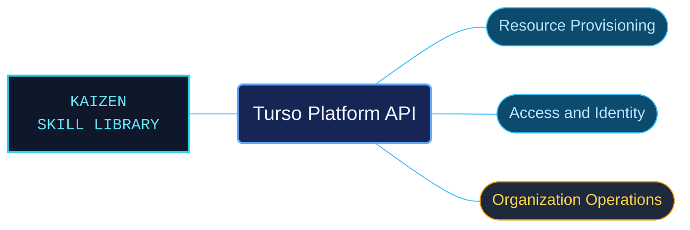

# Turso Platform API

Turso Platform API references for provisioning and administering hosted database resources. Endpoint families keep request fields, response contracts and authentication requirements close to the resource operation they describe.

Use when calling the Turso Platform API for authentication and scoped tokens, audit logs, database and group lifecycle, configuration, SQL credentials, SQLite uploads, locations, organizations, v2 invites, members, invoices, subscriptions, plans, usage, response codes, TypeScript provisioning or current user details. Preserve exact HTTP methods, endpoint versions, hostnames and token roles.

## What this skill helps with

| Task | Useful reference material |
| --- | --- |
| [Provision databases](database-lifecycle-api-workflows.md) | Find database lifecycle operations and their credential contracts. |
| [Manage platform identity](api-quickstart-tokens-and-user.md) | Check platform token and current-user endpoints. |
| [Administer organizations](organization-membership-and-billing-api.md) | Inspect invitation and membership operations with their request and response fields. |

## The work behind the references

The API material is grouped by resource and operation, preserving exact HTTP methods, endpoint versions and token scopes alongside the interpreted prose.

## Start here

Start with [SKILL.md](SKILL.md) and follow its context routes.

Use the authentication role and endpoint version specified by the selected operation. Examples require their documented credentials, account context and resource identifiers.

## Sources and license

Skill reference documentation is interpreted content for use in open source projects. Check against [official documentation sources](https://docs.turso.tech/api-reference) when dealing with defects or issues that may come up from interpreting this skill's references.

Licensed under **AGPL-3.0**; see [LICENSE](../../LICENSE). Part of the [Agent Kaizen](https://github.com/LevyBytes/agent-kaizen) skill library.
