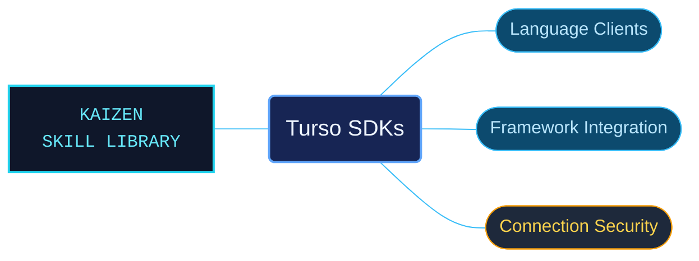

# Turso SDKs

Turso client references for connecting applications through language SDKs, frameworks and SQL over HTTP. Package-selection guidance separates local, remote and synchronized database clients before presenting their language-specific contracts.

Use when connecting applications to Turso with TypeScript, JavaScript, Python, Rust, Go, Java, Dart, Flutter, Kotlin, Swift, Ruby, PHP or C; selecting local, remote or sync SDKs; configuring ActiveRecord, ORMs and web frameworks; using SQL over HTTP, database authentication, scoped tokens, JWKS or permissions.

## What this skill helps with

| Task | Useful reference material |
| --- | --- |
| [Select a client package](sdk-selection-by-database-mode.md) | Choose a package for the language, runtime and connection mode; see [community clients](community-sdk-and-protocol-routes.md) for additional options. |
| [Integrate a web application](typescript-framework-workflows.md) | Find framework routes, [client and ORM quickstarts](typescript-orm-and-client-quickstarts.md), and [package and API contracts](typescript-package-and-api-selection.md). |
| [Configure authentication](database-authentication-guide.md) | Check database tokens, scopes, JWKS and token lifetime behavior. |

## The work behind the references

Language families and framework integrations are organized separately while retaining package names, setup dependencies and connection-mode distinctions.

## Start here

Start with [SKILL.md](SKILL.md) and follow its context routes.

Follow the language routes in SKILL.md for Python, Rust, Go, C, Java, Kotlin, Swift, PHP, Ruby, Dart and Flutter as well as JavaScript and TypeScript. Local clients, remote clients and synchronized replicas have different contracts.

## Sources and license

Skill reference documentation is interpreted content for use in open source projects. Check against [official documentation sources](https://docs.turso.tech/sdk) when dealing with defects or issues that may come up from interpreting this skill's references.

Licensed under **AGPL-3.0**; see [LICENSE](../../LICENSE). Part of the [Agent Kaizen](https://github.com/LevyBytes/agent-kaizen) skill library.
