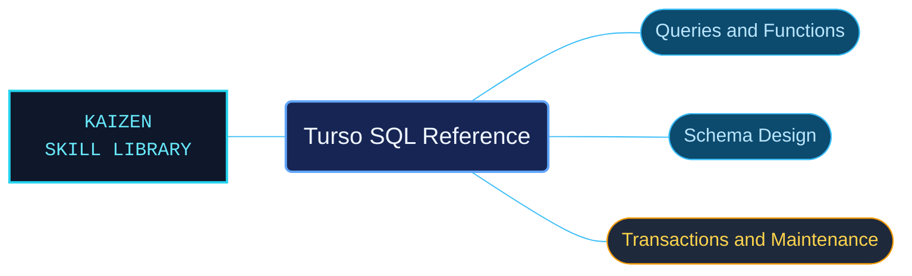

# Turso SQL Reference

Turso SQL references for checking query syntax, functions, schema operations and SQLite compatibility. The material connects SQL operations with the feature gates and binding conditions that determine where they can be used.

Use when checking Turso SQL syntax and SQLite compatibility, tursodb CLI flags and shell commands, data types, expressions, extensions, aggregate/array/date-time/FTS/JSON/math/scalar/vector/window functions, PRAGMAs, multi-process access, schema statements, custom types and domains, SELECT and row changes, transactions, analysis or vacuum.

## What this skill helps with

| Task | Useful reference material |
| --- | --- |
| [Read and change rows](queries-and-row-changes.md) | Look up SELECT, INSERT, UPDATE, DELETE and conflict-handling statements. |
| [Define database structures](schema-definition-and-changes.md) | Find table, index, view and trigger statements. |
| [Check compatibility and shell use](shell-and-compatibility-workflows.md) | Review shell options and the documented SQLite compatibility boundaries. |
| [Manage transactions and maintenance](transactions-and-database-maintenance.md) | Find transaction, analysis and database-maintenance operations. |

## The work behind the references

Statements and function families have focused catalogs, keeping complete syntax, examples and restrictions connected instead of separating them by arbitrary file boundaries.

## Start here

Start with [SKILL.md](SKILL.md) and follow its context routes.

Check experimental feature flags and binding requirements before adapting a query. Use the function-family routes for JSON, arrays, dates, windows, full-text search and vector operations.

## Sources and license

Skill reference documentation is interpreted content for use in open source projects. Check against [official documentation sources](https://docs.turso.tech/sql-reference/cli/getting-started) when dealing with defects or issues that may come up from interpreting this skill's references.

Licensed under **Apache-2.0**; see [LICENSE](../../LICENSE). Part of the [Agent Kaizen](https://github.com/LevyBytes/agent-kaizen) skill library.
