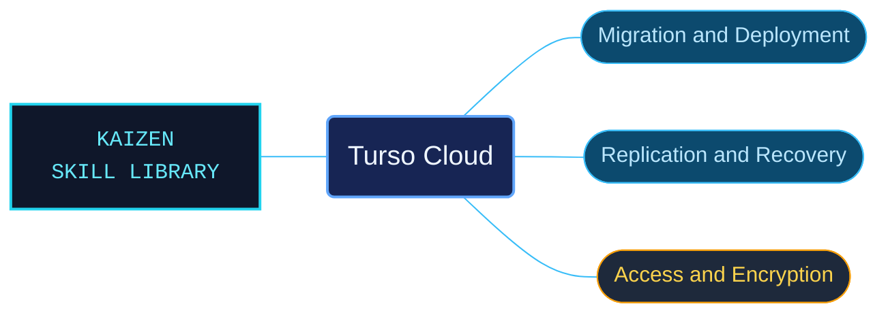

# Turso Cloud

Turso Cloud references for operating managed databases and their replicas. Migration, access control, encryption and recovery guidance is organized by workflow, with service-availability conditions retained alongside the procedures.

Use for Turso Cloud IP and VPC allow rules, durability, BYOK encryption, SQLite migration and limits, vector search, ATTACH, database branching, Edge Replicas, Embedded Replicas and deployment, Multi-DB Schemas, point-in-time recovery, AWS PrivateLink, extension versions and usage quotas. Preserve bundled availability, provider, plan and date restrictions.

## What this skill helps with

| Task | Useful reference material |
| --- | --- |
| [Restrict database access](ip-and-vpc-access-rules.md) | Find IP, CIDR and VPC endpoint rules through the CLI and API. |
| [Configure embedded replicas](embedded-replica-sync-and-encryption.md) | Check local replica setup, remote writes, synchronization and filesystem requirements. |
| [Plan recovery](point-in-time-database-recovery.md) | Understand restore targets, retention windows, checkpoint gaps and connection changes. |
| [Migrate SQLite data](sqlite-migration-wal-preparation.md) | Check import preparation and the documented CLI or API migration workflow. |

## The work behind the references

Cloud features have separate task catalogs that preserve provider, plan, region and date restrictions rather than presenting every capability as universally available.

## Start here

Start with [SKILL.md](SKILL.md) and follow its context routes.

Read the availability conditions before applying migration, replication or recovery guidance. The context router also covers BYOK encryption, PrivateLink, branching, vector storage and usage accounting.

## Sources and license

Skill reference documentation is interpreted content for use in open source projects. Check against [official documentation sources](https://docs.turso.tech/turso-cloud) when dealing with defects or issues that may come up from interpreting this skill's references.

Licensed under **AGPL-3.0**; see [LICENSE](../../LICENSE). Part of the [Agent Kaizen](https://github.com/LevyBytes/agent-kaizen) skill library.
